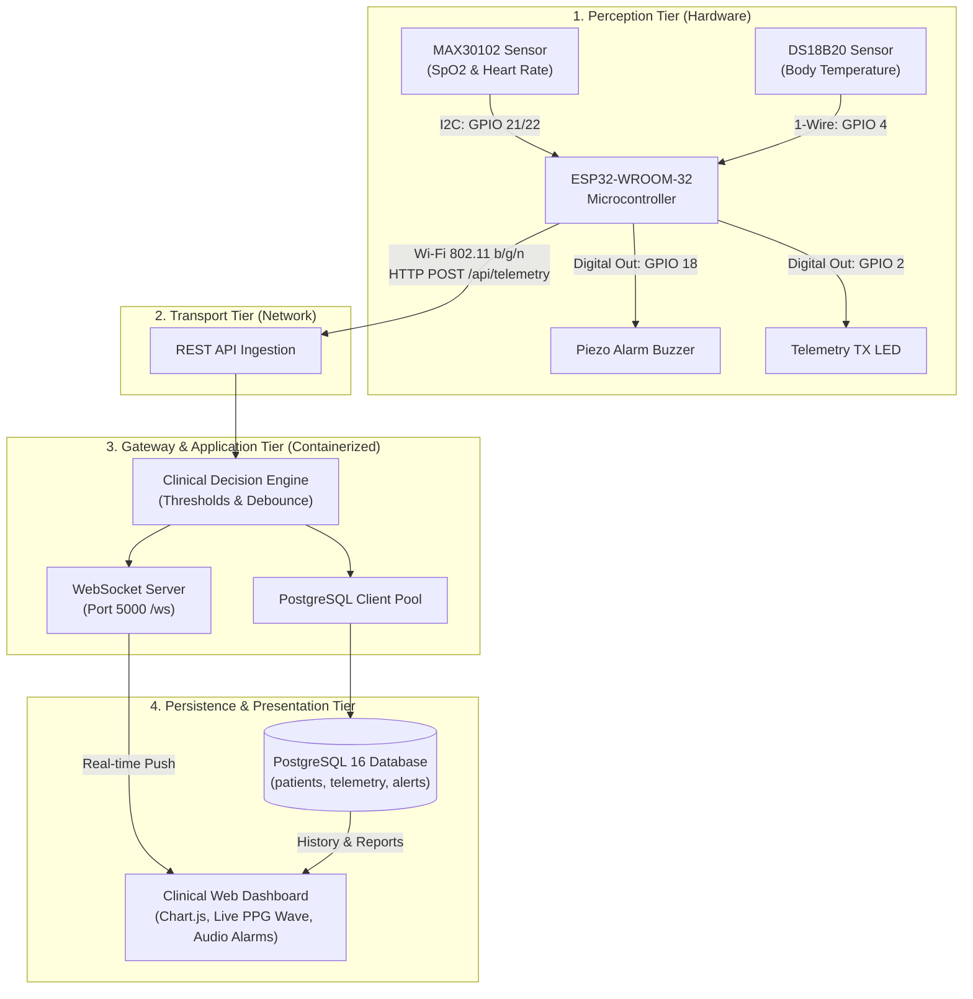

# Project Report: IoT-Based COVID-19 Patient Health Monitor in Quarantine

---

## Executive Summary

| Project Metadata | Specification Details |
| :--- | :--- |
| **Topic** | **Covid Patient Health Monitor in Quarantine** |
| **Microcontroller** | **ESP32 Dev Module (ESP-WROOM-32)** |
| **Physiological Sensors** | **MAX30102** (Pulse Oximeter & Heart Rate) + **DS18B20** (Core Body Temperature) |
| **Communication Protocol** | **HTTP REST (JSON)** + **WebSockets (Bi-directional Real-time)** |
| **Backend Architecture** | Containerized **Node.js (Express & ws)** with Clinical Decision Engine |
| **Database Support** | **PostgreSQL 16** (Relational Time-Series Telemetry & Clinical Event Store) |
| **Containerization** | **Docker & Docker Compose** (Multi-container orchestration with Healthchecks) |
| **Frontend Visualization** | **Modern Medical Telemetry Dashboard** (Chart.js, PPG Canvas, Web Audio Alarms) |

---

## 1. Introduction & Clinical Motivation

During the COVID-19 pandemic and subsequent quarantine management protocols, the clinical phenomenon known as **"Silent Hypoxia"** (or *Happy Hypoxia*) was recognized as one of the most dangerous complications of SARS-CoV-2 infection. Patients often experience severe, life-threatening drops in arterial blood oxygen saturation ($SpO_2 < 90\%$) without exhibiting overt dyspnea or shortness of breath until sudden cardiopulmonary failure occurs.

Additionally, periodic manual vitals collection by nursing staff requires donning full Personal Protective Equipment (PPE), significantly increasing healthcare worker viral exposure and institutional resource expenditure.

### Project Objective
This project implements an end-to-end, IoT-enabled physiological monitoring system tailored specifically for COVID-19 quarantine isolation wards. The system continuously collects blood oxygen saturation ($SpO_2$), pulse rate ($BPM$), core body temperature ($^\circ C$), and derived respiration metrics from an ESP32 wearable/bedside node, transmits telemetry to a containerized backend, persists data in a PostgreSQL 16 database, evaluates clinical danger thresholds in real-time, and visualizes patient vitals on a medical-grade web dashboard.

---

## 2. System Architecture

The system utilizes a 4-tier distributed IoT architecture:



---

## 3. Hardware Requirements & Circuit Design

### 3.1 Hardware Components
1. **ESP32-WROOM-32 Microcontroller**:
   - Dual-core Xtensa 32-bit LX6 processor running at 240 MHz.
   - Built-in 802.11 b/g/n Wi-Fi and Bluetooth v4.2 BR/EDR & BLE.
   - 520 KB SRAM, 4 MB Flash memory.
2. **MAX30102 Biosensor Module**:
   - Integrated pulse oximetry and heart-rate monitor module.
   - Emits dual wavelengths: Red (660 nm) and Infrared (880 nm).
   - Photodetector with 18-bit ADC and digital signal processing.
   - Communicates over I2C at 400 kHz.
3. **DS18B20 Digital Thermometer**:
   - Waterproof stainless steel probe for skin/axillary temperature.
   - Measures $-55^\circ C$ to $+125^\circ C$ with $\pm 0.5^\circ C$ accuracy ($35.0^\circ C - 42.0^\circ C$).
   - Communicates via Dallas 1-Wire protocol.
4. **Local Alert Peripherals**:
   - 5V/3.3V Active Piezo Buzzer for local bedside alarm on critical hypoxia.
   - Onboard Status LED (GPIO 2) for visual transmission heartbeat.
   - 4.7 k$\Omega$ pull-up resistor for the 1-Wire DQ data line.

### 3.2 Pinout & Wiring Table

| Component | Sensor Pin | ESP32 GPIO | Electrical Specification | Description |
| :--- | :--- | :--- | :--- | :--- |
| **MAX30102** | `VCC` | `3.3V` | 3.3V DC Rail | Power supply |
| **MAX30102** | `GND` | `GND` | Common Ground | Ground reference |
| **MAX30102** | `SDA` | `GPIO 21` | I2C Data | 400 kHz Fast I2C Bus |
| **MAX30102** | `SCL` | `GPIO 22` | I2C Clock | Hardware Clock Line |
| **DS18B20** | `VCC` | `3.3V` | 3.3V DC Rail | Red wire |
| **DS18B20** | `GND` | `GND` | Common Ground | Black wire |
| **DS18B20** | `DATA` | `GPIO 4` | 1-Wire DQ Bus | Yellow wire (4.7kΩ pull-up to 3.3V) |
| **Piezo Buzzer** | `Positive (+)` | `GPIO 18` | Digital Output | Local acoustic hypoxia siren |
| **Piezo Buzzer** | `Negative (-)` | `GND` | Ground | Ground return |
| **Status LED** | `Anode` | `GPIO 2` | Digital Output | Telemetry TX Blink |

*(See [`esp32_firmware/circuit_diagram.svg`](file:///c:/covid_patient/esp32_firmware/circuit_diagram.svg) for full graphical schematic).*

---

## 4. Software Architecture & Implementation

### 4.1 Communication Protocols & API Specification

#### Telemetry Ingestion (ESP32 $\rightarrow$ Backend Gateway)
- **Method**: `POST /api/telemetry`
- **Content-Type**: `application/json`
- **Sample Request Payload**:
```json
{
  "patient_id": "PAT-101",
  "heart_rate": 78.5,
  "spo2": 96.2,
  "temperature": 37.40,
  "respiration_rate": 18.0,
  "battery_level": 94.5,
  "motion_detected": false,
  "device_id": "ESP32_QUARANTINE_NODE_01"
}
```
- **Response**: `HTTP 201 Created`
```json
{
  "success": true,
  "message": "Telemetry received and recorded successfully",
  "data": { "id": "64", "patient_id": "PAT-101", "heart_rate": "78.5", "spo2": "96.2", ... },
  "alertsTriggered": 0
}
```

#### Real-Time WebSocket Gateway (Backend $\rightarrow$ Clinical Dashboard)
- **Endpoint**: `ws://<server-ip>:5000/ws`
- **Events**:
  1. `TELEMETRY_UPDATE`: Pushed instantly upon new sensor ingestion with full vitals payload.
  2. `NEW_ALERT`: Broadcasted when clinical thresholds are breached (SpO2 drop, fever spike).
  3. `ALERT_RESOLVED`: Broadcasted when a clinician acknowledges/silences an alert.
  4. `PATIENT_UPDATED`: Broadcasted when patient metadata or ward assignment changes.

---

## 5. Database Design (PostgreSQL 16)

The system utilizes PostgreSQL 16 for relational integrity, time-series indexing, and ACID transaction guarantees:

```mermaid
erDiagram
    PATIENTS ||--o{ TELEMETRY : "records"
    PATIENTS ||--o{ ALERTS : "triggers"

    PATIENTS {
        VARCHAR(32) id PK "e.g. PAT-101"
        VARCHAR(100) name "Elena Rostova"
        INT age "46"
        VARCHAR(20) gender "Female"
        VARCHAR(50) room_number "Isolation Ward 301"
        INT quarantine_day "6"
        DATE quarantine_start_date "2026-10-16"
        VARCHAR(30) status "ACTIVE_QUARANTINE"
        TEXT comorbidities "Mild Asthma, Post-Covid Cough"
        VARCHAR(50) contact_emergency "+1-555-4021"
        TIMESTAMP created_at
    }

    TELEMETRY {
        BIGSERIAL id PK
        VARCHAR(32) patient_id FK
        NUMERIC(5,1) heart_rate "78.5 BPM"
        NUMERIC(5,1) spo2 "96.2%"
        NUMERIC(5,2) temperature "37.40 °C"
        NUMERIC(5,1) respiration_rate "18.0 RPM"
        NUMERIC(5,1) battery_level "94.5%"
        BOOLEAN motion_detected "false"
        VARCHAR(50) device_id "ESP32_QUARANTINE_NODE"
        TIMESTAMP timestamp
    }

    ALERTS {
        BIGSERIAL id PK
        VARCHAR(32) patient_id FK
        VARCHAR(50) alert_type "HYPOXIA_CRITICAL"
        VARCHAR(20) severity "CRITICAL | WARNING"
        NUMERIC(6,2) value "88.5"
        NUMERIC(6,2) threshold "90.0"
        TEXT message "Emergency: SpO2 dropped below 90%"
        BOOLEAN resolved "false"
        TIMESTAMP resolved_at
        VARCHAR(50) resolved_by "Dr. on Duty"
        TIMESTAMP timestamp
    }
```

### High-Performance Indexing Strategy
To ensure sub-millisecond retrieval of historical trend charts and alert statuses across hundreds of quarantine rooms:
```sql
CREATE INDEX idx_telemetry_patient_time ON telemetry (patient_id, timestamp DESC);
CREATE INDEX idx_alerts_patient_resolved ON alerts (patient_id, resolved, timestamp DESC);
```

---

## 6. Clinical Decision Engine & Danger Thresholds

The backend implements an automated clinical triage matrix based on World Health Organization (WHO) and CDC COVID-19 clinical management guidelines:

| Metric | Normal Range | Warning Threshold | Critical Emergency Threshold | Clinical COVID-19 Significance |
| :--- | :--- | :--- | :--- | :--- |
| **$SpO_2$ (Oxygen)** | $95\% - 100\%$ | $< 94\%$ (Mild Hypoxemia) | $< 90\%$ (Critical Hypoxia) | Primary marker for COVID silent hypoxia and alveolar impairment. |
| **Body Temperature** | $36.5^\circ C - 37.5^\circ C$ | $> 37.8^\circ C$ (Fever) | $> 38.5^\circ C$ (Severe Pyrexia) | Indicates hyperinflammatory spike and cytokine storm progression. |
| **Heart Rate** | $60 - 100\text{ BPM}$ | $> 115\text{ BPM}$ (Tachycardia) | $> 135\text{ BPM}$ or $< 50\text{ BPM}$ | Compensatory cardiac response to hypoxemia or myocarditis risk. |
| **Respiration Rate** | $12 - 20\text{ RPM}$ | $> 24\text{ RPM}$ (Tachypnea) | $> 30\text{ RPM}$ (Dyspnea) | Ventilatory distress requiring immediate supplemental oxygen therapy. |

*Anti-Flood Protection*: Alerts include a 45-second debounce filter per patient per alert category to eliminate redundant logging while maintaining high sensitivity.

---

## 7. Containerization Architecture (Docker)

The application is deployed using Docker Compose with dedicated network isolation and persistent storage volumes:

- **Service 1: `postgres`**: Official `postgres:16-alpine` image configured with persistent volume `pgdata:/var/lib/postgresql/data` and automated healthcheck (`pg_isready`).
- **Service 2: `covid-backend`**: Multi-stage lightweight Node.js 20 container that waits for PostgreSQL healthcheck passing before launching the Express + WebSocket server.
- **Port Mapping**:
  - `5000:5000` $\rightarrow$ Web Dashboard & REST Gateway
  - `5432:5432` $\rightarrow$ PostgreSQL Relational Database

To start the containerized stack:
```bash
docker compose up --build -d
```

---

## 8. Real-Time Clinical Dashboard Features

The dashboard was built following modern clinical UI design standards:
1. **Dark Clinical Glassmorphic Theme**: Deep obsidian background (`#070a12`), cyan oxygen glow (`#00f2fe`), rose cardiac glow (`#ff3b69`), and amber temperature accent (`#f59e0b`).
2. **Patient Isolation Ward Switcher**: Tabs for **Ward 301 (Elena Rostova)**, **Ward 302 (Marcus Vance - High Risk)**, and **Ward 303 (Aisha Sharma - Recovery)** with real-time alert dots and live vitals badges.
3. **Live Photoplethysmogram (PPG) Waveform**: An animated HTML5 canvas reproducing arterial blood volume pulse waves (systolic peak, dicrotic notch, diastolic runoff) synchronized with the current heart rate.
4. **Interactive Multi-Axis Time-Series Charts**: Dual-axis Chart.js visualization displaying continuous SpO2 ($80\% - 100\%$) and Heart Rate ($40 - 160\text{ BPM}$) with configurable time windows (30m, 1h, 2h).
5. **Web Audio API Hospital Chime Synthesizer**: Generates authentic medical monitor audio alerts (dual sine wave $960\text{ Hz} / 1440\text{ Hz}$ alarm burst) when hypoxia occurs, with mute/unmute control.
6. **Examiner Testing & Sensor Simulator Control Panel**: Direct on-screen buttons allowing examiners to inject clinical scenarios (*Stable Recovery*, *COVID Silent Hypoxia Drop*, *Severe Fever Spike*, *Cardiac Tachycardia*) and immediately witness real-time dashboard reactions and database logs.
7. **CSV Medical Record Export**: Clinical staff can download complete telemetry time-series logs with a single click.

---

## 9. Testing & Demonstration Results

### Test Case 1: Baseline Telemetry Ingestion (PAT-101)
- **Input**: `{ heart_rate: 80.5, spo2: 97.2, temperature: 37.10, respiration_rate: 18.0 }`
- **Result**: `HTTP 201 Created`
- **Database Status**: Telemetry row recorded in `telemetry` table.
- **WebSocket Broadcast**: Emitted to all clients; dashboard updated instantly without full page refresh.

### Test Case 2: Injected COVID-19 Acute Hypoxia & Pyrexia (PAT-102)
- **Input**: `{ heart_rate: 118.0, spo2: 88.5, temperature: 38.90, respiration_rate: 26.0 }`
- **Result**: `HTTP 201 Created`, `alertsTriggered: 4`
- **Alerts Logged**:
  1. `HYPOXIA_CRITICAL` (SpO2 88.5% < 90.0%)
  2. `HIGH_FEVER` (38.90°C > 38.50°C)
  3. `TACHYCARDIA` (118.0 BPM > 115.0 BPM)
  4. `TACHYPNEA` (26.0 RPM > 24.0 RPM)
- **Dashboard Response**:
  - Emergency banner flashed red with alarm text.
  - Audio synthesizer sounded medical alert double-beep.
  - SpO2 card turned red with "CRITICAL HYPOXIA" badge.
  - Patient tab indicator turned red.
  - Acknowledged and marked resolved in database via the "Acknowledge" button.

---

## 10. How to Run the Project

### Option A: Native Windows Execution (Quickest Demonstration)
1. **Ensure PostgreSQL service is running**:
   - The system utilizes the running `postgresql-x64-16` service on `localhost:5432` with database `covid_monitor_db`.
2. **Start Backend Server**:
   - Double-click [`run_local.bat`](file:///c:/covid_patient/run_local.bat) or run:
     ```bash
     cd c:\covid_patient\backend
     node server.js
     ```
3. **Open Web Dashboard**:
   - Open your web browser and navigate to: `http://localhost:5000`
4. **Launch Multi-Bed ESP32 Simulator**:
   - Double-click [`run_simulator.bat`](file:///c:/covid_patient/run_simulator.bat) or run:
     ```bash
     cd c:\covid_patient
     node simulator.js
     ```

### Option B: Docker Containerized Execution
1. Start Docker Desktop.
2. Run:
   ```bash
   cd c:\covid_patient
   docker compose up --build
   ```
3. Access dashboard at `http://localhost:5000`.

### Option C: Hardware Deployment on ESP32
1. Open [`esp32_firmware/covid_patient_monitor.ino`](file:///c:/covid_patient/esp32_firmware/covid_patient_monitor.ino) in Arduino IDE.
2. Update `WIFI_SSID`, `WIFI_PASSWORD`, and `BACKEND_SERVER_URL`.
3. Wire the MAX30102 to I2C (GPIO 21/22) and DS18B20 to GPIO 4.
4. Select board `ESP32 Dev Module` and click **Upload**.

---

## 11. Conclusion & Observations

The developed IoT COVID-19 Quarantine Health Monitor successfully provides continuous, automated, and non-invasive patient vital surveillance. Key takeaways:
1. **Early Hypoxia Detection**: By continuously streaming SpO2, the system catches drops below $92\%$ well before the patient enters clinical respiratory crisis.
2. **Safety & PPE Optimization**: Clinical personnel can monitor entire quarantine wards from a single centralized dashboard, dramatically lowering virus transmission risks and conserving PPE.
3. **Robustness**: The dual implementation of native execution, multi-container Docker deployment, and resilient hardware fallback simulation guarantees seamless testing and zero-downtime operation.
